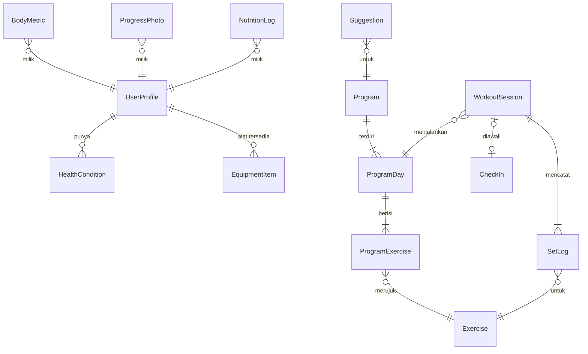

# 05 · Model Data

Semua data disimpan di IndexedDB lewat Dexie. Entitas di bawah adalah **tipe domain**
(`src/domain`). Tabel database boleh berbeda bentuk; mapper di `infrastructure/repositories`
yang menerjemahkan.

## Konvensi

| Hal | Aturan |
|---|---|
| ID | `string` dari `crypto.randomUUID()` |
| Waktu kejadian | `number` (epoch ms), nama berakhiran `At` → `createdAt`, `completedAt` |
| Tanggal kalender | `string` `YYYY-MM-DD` waktu lokal, nama berakhiran `Date` → `logDate` |
| Berat | `number` dalam kg, nama berakhiran `Kg` → `weightKg` |
| Panjang | `number` dalam cm, berakhiran `Cm` |
| Durasi | `number` dalam detik, berakhiran `Sec` |
| Enum | union string literal TypeScript, bukan `enum` |

## Diagram relasi



## Entitas

### Tipe bersama
```ts
type Weekday = 'mon' | 'tue' | 'wed' | 'thu' | 'fri' | 'sat' | 'sun';
```

### UserProfile (satu baris)
```ts
type Sex = 'male' | 'female';
type ActivityLevel = 'sedentary' | 'light' | 'moderate' | 'very' | 'extra';
type Experience = 'beginner' | 'intermediate';  // beginner = 0–6 bulan
type Goal = 'hypertrophy';                       // disiapkan untuk tujuan lain

interface UserProfile {
  id: 'me';
  name: string;
  sex: Sex;
  birthDate: string;          // umur dihitung, tidak disimpan
  heightCm: number;
  goal: Goal;
  experience: Experience;
  activityLevel: ActivityLevel;
  trainingDays: Weekday[];    // ['mon','tue','thu','fri']
  proteinGPerKg: number;      // default 2.0, rentang 1.6–2.2
  parqCompletedAt?: number;
  parqAllNo?: boolean;
  createdAt: number;
  updatedAt: number;
}
```

### HealthCondition
```ts
type BodyArea = 'shoulder_left' | 'shoulder_right' | 'elbow' | 'wrist' | 'lower_back'
              | 'upper_back' | 'neck' | 'hip' | 'knee_left' | 'knee_right' | 'ankle' | 'other';
type Severity = 'mild' | 'moderate' | 'severe';

interface HealthCondition {
  id: string;
  area: BodyArea;
  severity: Severity;
  painfulMovements: MovementPattern[];  // mis. ['vertical_push']
  note: string;
  active: boolean;
  createdAt: number;
}
```

### EquipmentItem
```ts
type Equipment = 'barbell' | 'dumbbell' | 'squat_rack' | 'bench' | 'cable' | 'leg_press'
               | 'smith' | 'pullup_bar' | 'kettlebell' | 'hack_squat' | 'leg_curl'
               | 'leg_extension' | 'chest_press_machine' | 'lat_pulldown' | 'ez_bar' | 'landmine' | 'trap_bar';

interface EquipmentItem { equipment: Equipment; available: boolean; }
```
Untuk kalkulator pelat, profil juga menyimpan `PlateInventory`:
```ts
interface PlateInventory { barKg: number; platesKg: number[]; dumbbellsKg: number[]; machineStepKg: number; }
// default: bar 20, pelat [25,20,15,10,5,2.5,1.25], dumbbell 2–40 kelipatan 2 kg (per tangan), mesin kelipatan 5 kg
```

### Exercise (perpustakaan, di-seed dari JSON)
```ts
type MovementPattern = 'horizontal_push' | 'vertical_push' | 'horizontal_pull' | 'vertical_pull'
                     | 'squat' | 'hinge' | 'lunge' | 'knee_flexion' | 'knee_extension'
                     | 'elbow_flexion' | 'elbow_extension' | 'shoulder_abduction'
                     | 'calf' | 'core';
type Muscle = 'chest' | 'back_lats' | 'back_upper' | 'shoulder_front' | 'shoulder_side'
            | 'shoulder_rear' | 'biceps' | 'triceps' | 'forearm' | 'quads' | 'hamstrings'
            | 'glutes' | 'calves' | 'abs';

interface Exercise {
  id: string;                     // slug: 'barbell-bench-press'
  name: string;                   // 'Bench Press'
  pattern: MovementPattern;
  mechanics: 'compound' | 'isolation';
  equipment: Equipment[];         // semua harus tersedia
  primaryMuscles: Muscle[];
  secondaryMuscles: Muscle[];
  loadType: 'barbell' | 'dumbbell' | 'machine' | 'cable' | 'bodyweight';
  measure: 'reps' | 'seconds';    // 'seconds' untuk gerakan tahan (plank)
  difficulty: 1 | 2 | 3;          // 1 = ramah pemula
  stressedAreas: BodyArea[];      // area yang terbebani (untuk substitusi)
  instructions: string[];
  commonMistakes: string[];
  media?: string;                 // path gambar
  isCustom: boolean;
}
```

### Program, ProgramDay, ProgramExercise
```ts
interface Program {
  id: string;
  name: string;                   // 'Upper/Lower 4 hari'
  templateId: string;
  startDate: string;
  mesocycleWeeks: number;         // 6 (5 minggu latihan + 1 deload)
  active: boolean;
  createdAt: number;
}

interface ProgramDay {
  id: string;
  programId: string;
  label: string;                  // 'Upper A'
  weekday: Weekday;
  order: number;
}

interface ProgramExercise {
  id: string;
  programDayId: string;
  exerciseId: string;
  order: number;
  sets: number;
  repMin: number;
  repMax: number;
  targetRir: number;              // 2
  restSec: number;
  currentWeightKg: number | null; // null = belum dikalibrasi
  substitutedFrom?: string;       // exerciseId asal jika diganti karena kondisi/alat
  substitutionReason?: 'health' | 'equipment' | 'user' | 'stagnation';
  progressionLocked: boolean;     // true = beban tidak naik otomatis (kondisi kesehatan sedang)
}
```

### CheckIn (hanya hari gym)
```ts
interface CheckIn {
  id: string;
  logDate: string;
  sleepHours: number;             // 0–12, langkah 0.5
  soreness: 1 | 2 | 3 | 4 | 5;     // 1 = tidak pegal
  energy: 1 | 2 | 3 | 4 | 5;       // 5 = sangat bertenaga
  painAreas: BodyArea[];          // nyeri tajam hari ini
  bodyWeightKg?: number;
  readiness: 'green' | 'yellow' | 'red';  // hasil domain/trainer/readiness
  createdAt: number;
}
```

### WorkoutSession & SetLog
```ts
interface WorkoutSession {
  id: string;
  programDayId: string;
  dayLabel: string;
  checkInId?: string;
  readiness: 'green' | 'yellow' | 'red';       // dipakai progresi: sesi merah diabaikan
  logDate: string;
  startedAt: number;
  finishedAt?: number;
  status: 'active' | 'finished' | 'abandoned';
  adjustment: 'none' | 'reduced' | 'light' | 'deload';
  isDeloadWeek: boolean;
  plan: SessionExercisePlan[];                // salinan resep saat sesi dimulai
  summary?: SessionSummary;                   // durasi, set, tonase, PR, beban berikutnya
}

interface SetLog {
  id: string;
  sessionId: string;
  exerciseId: string;
  programExerciseId?: string;
  setNumber: number;
  kind: 'warmup' | 'working';
  weightKg: number;
  reps: number;
  rir?: number;                   // 0–5 (5 = "5+")
  completedAt?: number;           // undefined = belum dicentang
  restEndsAt?: number;            // timer dihitung dari sini, tahan terhadap aplikasi ditutup
}
```

### BodyMetric
```ts
interface BodyMetric {
  id: string;
  logDate: string;
  weightKg?: number;
  neckCm?: number; chestCm?: number; waistCm?: number; hipCm?: number;
  armCm?: number; thighCm?: number;
  createdAt: number;
}
```

### ProgressPhoto
```ts
interface ProgressPhoto {
  id: string;
  logDate: string;
  pose: 'front' | 'side' | 'back';
  blob: Blob;                     // JPEG, sisi terpanjang 1080 px
  createdAt: number;
}
```

### Nutrisi
```ts
interface NutritionLog {
  id: string;
  logDate: string;
  label: string;                  // 'Nasi + ayam'
  kcal: number;
  proteinG: number;
  carbsG?: number;
  fatG?: number;
  createdAt: number;
}
interface WaterLog { id: string; logDate: string; ml: number; createdAt: number; }
interface SavedMeal { id: string; label: string; kcal: number; proteinG: number; carbsG?: number; fatG?: number; }
```

### Suggestion
```ts
// Saran dihitung ulang dari data terkini (SuggestionDraft: ruleId, targetKey, category, params, action).
// Yang disimpan di tabel `suggestions` hanya keputusan pengguna:
interface ResolvedSuggestion {
  id: string;
  programId: string;
  ruleId: string;                 // 'low_weekly_volume'
  targetKey: string;              // mis. 'chest'; kunci jeda 14 hari setelah diabaikan
  status: 'applied' | 'dismissed';
  resolvedAt: number;
}

type SuggestionAction =
  | { kind: 'add_sets'; programExerciseId: string; sets: number }
  | { kind: 'remove_sets'; programExerciseId: string; sets: number }
  | { kind: 'add_exercise'; programDayId: string; exerciseId: string; sets: number; repMin: number; repMax: number }
  | { kind: 'swap_exercise'; programExerciseId: string; exerciseId: string }
  | { kind: 'move_day'; programDayId: string; weekday: Weekday }
  | { kind: 'start_deload' }
  | { kind: 'regenerate_program'; trainingDays: Weekday[] }
  | { kind: 'set_calorie_offset'; deltaKcal: number }
  | { kind: 'open_screen'; screen: 'parq' | 'backup' };
```
Menerapkan saran menyimpan snapshot bagian program yang berubah, sehingga bisa di-undo.

### Achievement & Settings
```ts
interface UnlockedAchievement { id: string; achievementId: string; unlockedAt: number; }

interface Settings {
  id: 'settings';
  reminderTime?: string;          // '17:30'
  hapticsEnabled: boolean;
  lastBackupAt?: number;
}
```

Preferensi **tema** tidak disimpan di Settings, melainkan di `localStorage` (`kratos:theme`),
karena harus terbaca sinkron sebelum halaman digambar agar tidak berkedip (lihat `src/shared/lib/theme.ts`).

## Skema Dexie

```ts
// src/infrastructure/db/database.ts (SCHEMA_V1)
db.version(1).stores({
  profile:          'id',
  healthConditions: 'id',
  equipment:        'equipment',        // hanya alat yang tersedia yang disimpan
  exercises:        'id, pattern',      // baris berisi juga panduan (guide)
  programs:         'id',
  programDays:      'id, programId',
  programExercises: 'id, programDayId, exerciseId',
  checkIns:         'id, &logDate',
  sessions:         'id, logDate, status, programDayId',
  setLogs:          'id, sessionId, exerciseId, completedAt, [exerciseId+completedAt]',
  bodyMetrics:      'id, logDate',
  photos:           'id, logDate, pose',
  nutritionLogs:    'id, logDate',
  waterLogs:        'id, logDate',
  savedMeals:       'id',
  suggestions:      'id, programId, status, ruleId',
  achievements:     'id, &achievementId',
  settings:         'id',
});
```

Hanya kolom yang dicari/diurutkan yang diindeks. Kolom lain tetap tersimpan.
**IndexedDB tidak bisa mengindeks nilai boolean**, jadi `active`/`isCustom` disaring di memori (jumlah barisnya kecil).
Baris `settings` (`id: 'settings'`) menyimpan `catalogVersion`, `inventory` (pelat/dumbbell), dan `lastBackupAt`.

## Migrasi

| Versi | Tahap | Perubahan |
|---|---|---|
| 1 | 3 | Skema awal (`SCHEMA_V1`) |
| 2 | 6 | Tabel `activityLogs: 'id, logDate'` (aktivitas hari pemulihan) |

Test migrasi: `src/infrastructure/db/migrations.test.ts` membuka database v1 berisi data lalu memastikan data utuh di versi terbaru.

- Setiap perubahan skema = versi baru (`db.version(2)...upgrade(tx => ...)`), **tidak pernah** mengubah versi lama.
- Satu file per migrasi di `infrastructure/db/migrations/` dengan test yang memakai `fake-indexeddb`.
- Seed perpustakaan gerakan memakai kolom `seedVersion` di settings; gerakan bawaan diperbarui tanpa menyentuh gerakan buatan pengguna (`isCustom: true`).

## Keamanan data

- Panggil `navigator.storage.persist()` saat onboarding agar browser tidak menghapus data saat penyimpanan penuh.
- Safari dapat menghapus data situs yang tidak dibuka 7 hari **jika tidak dipasang ke Home Screen**. Onboarding wajib mengarahkan pengguna memasang aplikasi.
- Pengingat backup muncul jika `lastBackupAt` lebih dari 14 hari.
