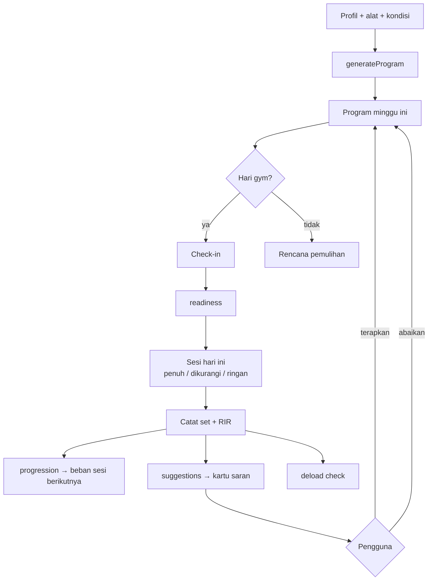

# Mesin Trainer

"Otak" aplikasi yang menggantikan peran trainer. Seluruhnya berada di `src/domain/` sebagai
**fungsi murni**: input data → output keputusan. Tidak menyimpan apa pun sendiri.

| Dokumen | Pertanyaan yang dijawab | Kode |
|---|---|---|
| [01-pembuatan-program.md](01-pembuatan-program.md) | Program apa yang cocok untuk saya? | `domain/program/generateProgram.ts` |
| [02-progresi-beban.md](02-progresi-beban.md) | Berapa beban saya sesi berikutnya? | `domain/strength/progression.ts` |
| [03-autoregulasi-checkin.md](03-autoregulasi-checkin.md) | Apakah hari ini saya latihan penuh? | `domain/trainer/readiness.ts` |
| [04-saran-trainer.md](04-saran-trainer.md) | Apa yang perlu diperbaiki di program saya? | `domain/trainer/suggestions/` |
| [05-substitusi-gerakan.md](05-substitusi-gerakan.md) | Gerakan ini tidak bisa/aman, gantinya apa? | `domain/trainer/substitution.ts` |
| [06-deload.md](06-deload.md) | Kapan saya perlu minggu ringan? | `domain/trainer/deload.ts` |

## Alur keputusan dalam satu minggu

## Prinsip

1. **Deterministik.** Input sama → output sama. Tidak ada angka acak.
2. **Bisa dijelaskan.** Setiap keputusan membawa `reason` (kode + teks) yang ditampilkan ke pengguna, mis. "Beban naik karena semua set mencapai 12 repetisi".
3. **Pengguna menang.** Editan manual pengguna tidak ditimpa otomatis. Mesin hanya mengusulkan.
4. **Aman lebih dulu.** Jika aturan bertentangan, pilih yang lebih ringan.
